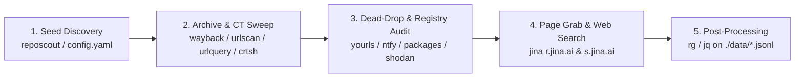

# Scanners

Self-contained telemetry collectors and search CLIs for investigating autonomous AI-agent activity across host banners, URL sandboxes, link shorteners, web pages, web archives, Certificate Transparency logs, pub/sub dead-drops, repository file trees, and package registries.

Each tool in `scanners/<tool>/` consists of two standalone PEP 723 `uv` scripts (`scan.py` and `search.py`) with zero internal cross-imports, shares a uniform 9-key YAML configuration (`scanners/config.yaml`), and writes deduplicated 7-key MISP-shaped JSONL records to `./data/<tool>.jsonl`.

---

## 1. History & Architecture

| Milestone | Technical Change | Operational Purpose |
| :--- | :--- | :--- |
| **1. Seed Extraction** | Extracted domains, query parameters, shortlinks, and callback topics from public agent trajectory corpora (`ClawBench`, `ClawBenchV2Trace`, `StepFun` UAT, `EvoMap`, `x402`) and sandbox traces. | Established the 5-tier surface taxonomy and initial query set in `scanners/config.yaml`. |
| **2. Mode Split (`scan` vs `search`)** | Separated every tool into `scan.py` (incremental polling over `scan.window_hours` and `scan.targets`) and `search.py` (broad historical sweeps over `queries` or CLI flags). | Allows continuous cron monitoring (`scan`) alongside targeted retrospective hunting (`search`). |
| **3. Pure Raw MISP Collection** | Removed inline regex filtering from scanner code and standardized output on a 7-key MISP record (`id`, `event`, `target`, `http`, `attributes`, `tags`, `raw`). | Preserves complete raw evidence (`http.content` and `raw` JSON) so indicator regexes can evolve during post-processing without re-fetching. |
| **4. Uniform 9-Key Configuration** | Consolidated all per-scanner YAML schemas into the same 9 keys (`base_url`, `api_key`, `user_agent`, `headers`, `timeout`, `delay`, `limit`, `queries`, `scan`). | Eliminates tool-specific config keys and supports global or per-call HTTP header/User-Agent overrides. |
| **5. Fail-Loud Execution** | Removed silent cross-service fallbacks and defensive HTTP exception swallowing across all 20 scripts (`vulture` + `ruff` verified). | Ensures missing API keys (`SHODAN_API_KEY`, `URLQUERY_API_KEY`), upstream HTTP failures, and malformed responses fail immediately with loud tracebacks instead of silently returning partial or substitute data. |



---

## 2. Scanner Matrix

| Tool | `scan` (Incremental / Feed) | `search` (Historical / Query) | Auth Env Var | Request / Protocol Behavior | Timeout / Delay / Limit | Tags Emitted | Output File | Upstream Docs |
| :--- | :--- | :--- | :--- | :--- | :--- | :--- | :--- | :--- |
| [`shodan`](shodan/README.md) | Polls `/shodan/alert/info` + `scan.targets` with `after:<YYYY-MM-DD>` | Queries `/shodan/host/search`, `/shodan/host/count`, `/shodan/host/{ip}`, `/dns/domain/{domain}` | `SHODAN_API_KEY` (required) | Uses `Shodan-Python/1.31.0` UA; raises `RuntimeError` if `SHODAN_API_KEY` is unset | `90s` / `1.0s` / `50` | `banner`, `alert`, `count`, `host`, `dns` | `./data/shodan.jsonl` | [developer.shodan.io/api](https://developer.shodan.io/api) |
| [`urlquery`](urlquery/README.md) | Queries `/public/v1/search/reports/` over `date:[<cutoff> TO <now>]` | Queries `/public/v1/search/reports/`, `/public/v1/report/{id}`, `/public/v1/reputation/check/` | `URLQUERY_API_KEY` (required) | Sends `X-Apikey` header; raises `RuntimeError` if `URLQUERY_API_KEY` is unset | `90s` / `3.0s` / `50` | `report`, `reputation` | `./data/urlquery.jsonl` | [urlquery.net/help/search](https://urlquery.net/help/search) |
| [`yourls`](yourls/README.md) | Polls `scan.targets` (instance roots, `sitemap.xml`, `yourls-api.php?action=stats`) | Fetches `<shorturl>+` stats pages and `yourls-api.php` actions (`url-stats`, `expand`, `stats`, `db-stats`) | None | Waits `1.25s` and retries once when response body is `<500` bytes (anti-bot challenge) | `45s` / `3.0s` / `50` | `discovery`, `stats` | `./data/yourls.jsonl` | [yourls.org/docs](https://yourls.org/docs) |
| [`jina`](jina/README.md) | Renders URLs in `scan.targets` (or `-u`) via `https://r.jina.ai/<url>` | Searches `queries` (or `-q`) via `https://s.jina.ai/<query>` | `JINA_API_KEY` (optional) | Sends `Authorization: Bearer ***` when `JINA_API_KEY` is set; fails loudly on HTTP errors | `120s` / `5.0s` / `50` | `reader`, `s_jina` | `./data/jina.jsonl` | [jina.ai/reader](https://jina.ai/reader/) |
| [`wayback`](wayback/README.md) | Unsupported (warns on `stderr`, exits `0`) | Queries `http://web.archive.org/cdx/search/cdx` (`matchType=prefix`, `collapse=urlkey`) | None | Filters crawler anti-bot noise (`NOISE_SUBSTRINGS`); fails loudly on HTTP errors | `120s` / `5.0s` / `200` | `cdx` | `./data/wayback.jsonl` | [archive.org CDX](https://archive.org/developers/wayback-cdx-server.html) |
| [`urlscan`](urlscan/README.md) | Queries `/api/v1/search/?q=date:>now-<h>h` | Queries `/api/v1/search/` and `/api/v1/result/{uuid}/` | `URLSCAN_API_KEY` (optional) | Sends `API-Key` header if set; works unauthenticated for public scans from the last 30 days | `45s` / `2.0s` / `100` | `result` | `./data/urlscan.jsonl` | [urlscan.io/docs/api](https://urlscan.io/docs/api/) |
| [`crtsh`](crtsh/README.md) | Unsupported (warns on `stderr`, exits `0`) | Queries `https://crt.sh/?q=<pattern>&output=json&exclude=expired` | None | Filters known static baseline certificates (`BASELINE_SERIALS`); fails loudly on HTTP errors | `90s` / `10.0s` / `100` | `certificate` | `./data/crtsh.jsonl` | [crt.sh](https://crt.sh/) |
| [`ntfy`](ntfy/README.md) | Unsupported (warns on `stderr`, exits `0`) | Polls `https://ntfy.sh/<topic>/json?poll=1&since=all` | None | Parses NDJSON message lines (`event == "message"`); fails loudly on HTTP errors | `25s` / `3.0s` / `50` | `message` | `./data/ntfy.jsonl` | [docs.ntfy.sh](https://docs.ntfy.sh/subscribe/api/) |
| [`reposcout`](reposcout/README.md) | Fetches recursive file trees for `scan.targets` and emits candidate data files | Searches `github:<owner/repo>` (`/git/trees/{branch}?recursive=1`) and `hf:<org/dataset>` (`/api/datasets/{id}/tree/{branch}`) | `GITHUB_TOKEN` (optional) | Strips `Authorization` header on HuggingFace requests; filters by `CANDIDATE_EXTENSIONS` (`.json`, `.jsonl`, `.parquet`, etc.) | `30s` / `2.0s` / `200` | `github`, `hf` | `./data/reposcout.jsonl` | [GitHub Trees API](https://docs.github.com/en/rest/git/trees) · [HF Hub API](https://huggingface.co/docs/hub/api) |
| [`packages`](packages/README.md) | Polls PyPI `rss/updates.xml` and RubyGems `activity/just_updated.json` | Queries RubyGems (`/api/v1/search.json`), npm (`/-/v1/search`), and PyPI (`/pypi/{pkg}/json`) | None | Parses full XML/JSON feed (`full_text`) before truncating `http.content` to 20,000 chars | `45s` / `2.0s` / `50` | `pypi_rss`, `rubygems_recent`, `rubygems`, `npm`, `pypi` | `./data/packages.jsonl` | [RubyGems API](https://guides.rubygems.org/rubygems-org-api/) · [PyPI API](https://docs.pypi.org/api/) |

---

## 3. Surface Taxonomy (`scanners/config.yaml`)

Targets in `scanners/config.yaml` are grouped into five operational tiers derived from trajectory datasets and sandbox telemetry:

| Tier | Category | Representative Hosts & Surfaces | Collection Rule |
| :--- | :--- | :--- | :--- |
| **Tier 1** | **Public Dead-Drops & Activity Hosts** | `goto.unm.edu`, `t.mdcdev.me`, `yourls.space`, `url.popcat.xyz`, `ntfy.sh`, `urlquery.net`, `webhook.site`, `dpaste.org`, `0x0.st`, `zenbin.org`, `catbox.moe` | Swept directly via `yourls`, `ntfy`, `urlquery`, `urlscan`, and `wayback`. |
| **Tier 2** | **Bespoke / Operator-Controlled Domains** | `hysandbox.tencent-cloud.com`, `www.x402.dev`, `facilitator.x402.dev`, `evomap.ai`, `chat.z.ai`, `s2s-api-Verify.stepfun-inc.com`, `slack.uat.stepfun-inc.com` | Enumerated via `crtsh search`, `wayback search`, `urlscan search`, and `shodan search`. |
| **Tier 3** | **Public Content & Package Registries** | `github.com`, `huggingface.co`, `rubygems.org`, `pypi.org`, `npmjs.com`, `ditu.amap.com`, `pre-amap-pc-ssr.amap.com`, `web.archive.org` | Targeted via `reposcout`, `packages`, `wayback`, and `jina`. |
| **Tier 4** | **High-Traffic Mainstream Platforms** | `google.com`, `bing.com`, `duckduckgo.com`, `gmail.com`, `slack.com`, `reddit.com`, `linkedin.com`, `cloudflare.com` | Never scanned at the bare domain level; queried only with high-specificity paths or query parameters. |
| **Tier 5** | **Placeholder / Local / Fixture Hosts** | `localhost`, `127.0.0.1`, `example.com`, `api.Promo.com`, `mail.company.com`, `portal.gov.example`, `www.Slowloris.com` | Excluded from external scanning. |

---

## 4. Installation & Environment Setup

### Installation Methods

| Setup Mode | Commands | When to Use |
| :--- | :--- | :--- |
| **Editable Package Install** | `cd scanners && uv venv && uv pip install -e ".[dev]"` | Installs the `scanners` dispatcher, all 10 `<tool>` console aliases, `omegaconf`, `python-dotenv`, `ruff`, and `vulture`. |
| **Zero-Install `uv run`** | `uv run scanners/<tool>/<scan\|search>.py [flags]` | Runs any script directly using its inline PEP 723 dependency header without creating a project virtualenv. |

### Environment Variables (`scanners/.env` or repo-root `.env`)

Copy `scanners/.env.example` to `scanners/.env`. Every script loads `scanners/.env` and repo-root `.env` automatically without overriding existing shell environment variables.

| Variable | Scanner | Requirement | Auth Header / Parameter | Behavior When Unset |
| :--- | :--- | :--- | :--- | :--- |
| `SHODAN_API_KEY` | `shodan` | Required | `?key=<token>` query param (redacted to `?key=***` in output) | Raises `RuntimeError("SHODAN_API_KEY is required")` |
| `URLQUERY_API_KEY` | `urlquery` | Required | `X-Apikey: ***` request header | Raises `RuntimeError("URLQUERY_API_KEY is required")` |
| `JINA_API_KEY` | `jina` | Optional | `Authorization: Bearer ***` request header | `scan` uses public `r.jina.ai` quota; `search` queries `s.jina.ai` unauthenticated |
| `URLSCAN_API_KEY` | `urlscan` | Optional | `API-Key: ***` request header | Queries public 30-day search index anonymously |
| `GITHUB_TOKEN` | `reposcout` | Optional | `Authorization: Bearer ***` request header | Uses unauthenticated GitHub REST limit (60 req/hr per IP); raised to 5,000 req/hr with token |

---

## 5. How to Run (`4` Invocation Methods)

| Method | Syntax | Example |
| :--- | :--- | :--- |
| **1. Unified CLI (`scanners`)** | `scanners <tool> <scan\|search> [flags]` | `scanners wayback search -d evomap.ai --json` |
| **2. Per-Tool Console Alias** | `<tool> <scan\|search> [flags]` | `wayback search -d evomap.ai --json` |
| **3. Standalone `uv run` Script** | `uv run scanners/<tool>/<scan\|search>.py [flags]` | `uv run scanners/wayback/search.py -d evomap.ai --json` |
| **4. Direct Executable Script** | `./scanners/<tool>/<scan\|search>.py [flags]` | `./scanners/wayback/search.py -d evomap.ai --json` |

> **Default mode note**: Invoking `scanners <tool>` or `<tool>` with no mode argument defaults to `scan` (for example, `shodan --json` runs `shodan scan --json`).

### Top-Level Dispatcher Flags (`scanners/cli.py`)

| Command | Description |
| :--- | :--- |
| `scanners --list` | Print a status table of all 10 scanners and whether `scan` and `search` are `supported` or `unsupported`. |
| `scanners --self-test` | Run offline unit and schema self-tests across all 20 `scan.py` and `search.py` scripts. |
| `scanners <tool> --self-test` / `<tool> --self-test` | Run offline self-tests for a single tool's `scan.py` and `search.py`. |
| `scanners <tool> <scan\|search> --help` | Show full CLI flag reference for a specific scanner and mode. |

### Shared Script Flags (Available on All Supported Scanners)

| Flag | Type | Default | Description |
| :--- | :--- | :--- | :--- |
| `-c`, `--config <path>` | `Path` | `scanners/config.yaml` | Path to the YAML configuration file. |
| `--limit <int>` | `int` | `<tool>.limit` | Maximum records or targets processed per query/feed. |
| `--user-agent <str>` | `str` | `<tool>.user_agent` | Override the HTTP `User-Agent` request header. |
| `--header "Key: Value"` | `list[str]` | `[]` | Repeatable custom HTTP header merged on top of config headers. |
| `--output <path>` | `Path` | `./data/<tool>.jsonl` | Override the output JSONL file path. |
| `--no-save` | `bool` | `False` | Do not write or append records to disk (read-only run). |
| `--json` | `bool` | `False` | Print emitted JSONL records to `stdout` (one JSON object per line). |
| `--new-only` | `bool` | `False` | In `search` mode, emit only records whose `id` is not yet in `./data/<tool>.jsonl` (`scan` always deduplicates). |
| `--self-test` | `bool` | `False` | Execute the script's offline mock-fetch and MISP schema self-test and exit `0`. |

---

## 6. Input Data Shape (`scanners/config.yaml`)

Every scanner block in `scanners/config.yaml` has the exact same 9 keys and inherits fallback values from top-level `defaults`:

| Key | Type | Top-Level Default | Used By | Description |
| :--- | :--- | :--- | :--- | :--- |
| `base_url` | `str` | Tool-specific | `scan`, `search` | Primary upstream REST API or feed base URL. |
| `api_key` | `str` | `""` | `scan`, `search` | API key resolved via OmegaConf `${oc.env:VAR,''}` or `.env`. |
| `user_agent` | `str` | `"Mozilla/5.0 (compatible; incident-investigation-scanners/1.0; +https://github.com/transluce)"` | `scan`, `search` | Default HTTP `User-Agent` (`shodan` overrides to `"Shodan-Python/1.31.0"`). |
| `headers` | `dict[str, str]` | `Accept`, `Accept-Language`, `Cache-Control` | `scan`, `search` | HTTP headers merged with `defaults.headers` and CLI `--header` flags. |
| `timeout` | `float` | `60.0` | `scan`, `search` | Per-request socket timeout in seconds. |
| `delay` | `float` | `2.0` | `scan`, `search` | Polite sleep delay (in seconds) between consecutive queries or targets. |
| `limit` | `int` | `50` | `scan`, `search` | Maximum items emitted per query or feed poll. |
| `queries` | `list[str]` | `[]` | `search` | Flat list of search strings iterated when `<tool> search` runs without CLI query flags. |
| `scan` | `dict` | `{window_hours, targets}` | `scan` | Incremental scan block containing `window_hours` (`float`/`int`) and `targets` (`list[str]`). |

```yaml
data_dir: "../data"

defaults:
  user_agent: "Mozilla/5.0 (compatible; incident-investigation-scanners/1.0; +https://github.com/transluce)"
  headers:
    Accept: "application/json, text/plain, */*"
    Accept-Language: "en-US,en;q=0.9"
    Cache-Control: "no-cache"
  timeout: 60.0
  delay: 2.0
  limit: 50

<tool>:
  base_url: "https://..."
  api_key: "${oc.env:TOOL_API_KEY,''}"
  user_agent: "${defaults.user_agent}"
  headers:
    Accept: "application/json"
  timeout: 60.0
  delay: 2.0
  limit: 50
  queries:
    - "search query 1"
  scan:
    window_hours: 24
    targets:
      - "incremental target 1"
```

---

## 7. Output Data Shape (`./data/<tool>.jsonl`)

Every record emitted to `stdout` (`--json`) or appended to `./data/<tool>.jsonl` strictly conforms to a 7-key MISP-shaped dictionary (`RECORD_KEYS = {"id", "event", "target", "http", "attributes", "tags", "raw"}`).

### Top-Level & Nested Schema Reference

| Field Path | Type | Description |
| :--- | :--- | :--- |
| **`id`** | `str` | Deterministic deduplication key: `<scanner>:<12-hex-sha256-prefix>` (e.g., `"wayback:a4f901c28b11"`). |
| **`event.uuid`** | `str` | Deterministic UUIDv4-formatted identifier derived from the record's canonical identity seed. |
| **`event.info`** | `str` | Human-readable summary: `"<scanner> <mode>: <query_text>"`. |
| **`event.scanner`** | `str` | Scanner name (`"shodan"`, `"urlquery"`, `"yourls"`, `"jina"`, `"wayback"`, `"urlscan"`, `"crtsh"`, `"ntfy"`, `"reposcout"`, `"packages"`). |
| **`event.mode`** | `str` | Execution mode (`"scan"` or `"search"`). |
| **`event.query`** | `str` | Exact query string, target URL, or feed identifier that produced the record. |
| **`event.observed_at`** | `str` | Upstream observation timestamp in ISO-8601 UTC (`YYYY-MM-DDTHH:MM:SSZ`); falls back to `collected_at`. |
| **`event.collected_at`** | `str` | Local collection timestamp in ISO-8601 UTC (`YYYY-MM-DDTHH:MM:SSZ`). |
| **`target.url`** | `str \| null` | Primary observed URL, report URL, or archive replay URL. |
| **`target.domain`** | `str \| null` | Normalized target hostname. |
| **`target.ip`** | `str \| null` | Observed IPv4/IPv6 address (populated by `shodan`, `urlquery`, `urlscan`). |
| **`target.port`** | `int \| null` | Observed network port (populated by `shodan`). |
| **`target.asn`** | `str \| int \| null` | Autonomous System Number (populated by `shodan`, `urlquery`, `urlscan`). |
| **`http.method`** | `str` | HTTP verb used by the collector (`"GET"`). |
| **`http.request_url`** | `str` | Upstream request URL with secret query parameters redacted (`?key=***`). |
| **`http.request_headers`** | `dict[str, str]` | Sent HTTP headers with secret headers (`Authorization`, `X-Apikey`, `API-Key`) redacted to `"***"`. |
| **`http.status`** | `int` | HTTP response status code (`200`, `401`, `404`, `502`, or `-1` on transport error). |
| **`http.response_headers`** | `dict[str, str]` | Lowercased HTTP response headers returned by the upstream server. |
| **`http.content_type`** | `str \| null` | Normalized response or target MIME type. |
| **`http.content_length`** | `int` | Byte/character length of the upstream HTTP response body. |
| **`http.content_sha256`** | `str` | Hex SHA-256 digest of the full HTTP response body. |
| **`http.content`** | `str` | Response body or extracted item text, capped at `20,000` characters. |
| **`attributes[]`** | `list[dict]` | List of 5-key MISP attribute objects: `{type, category, value, to_ids, comment}`. Always includes `sha256` (`Payload delivery`) plus populated `url`, `domain`, `ip-dst`, `port`, `AS`, `filename`, `text`, or `x509-fingerprint-sha256`. |
| **`tags[]`** | `list[str]` | Sorted classification tags combining `scanner`, `mode`, and source/fallback tags: `sorted({SCANNER_NAME, MODE_NAME, *tags})` (e.g., `["cdx", "search", "wayback"]`, `["count_fallback", "search", "shodan"]`). |
| **`raw`** | `dict[str, Any]` | Untruncated upstream JSON object or parsed row metadata for the record. |

### Concrete Record Example

```json
{
  "id": "wayback:ba9b2e078c31",
  "event": {
    "uuid": "ba9b2e07-8c31-4e32-89a1-ba9b2e078c31",
    "info": "wayback search: amap-pc-ssr.amap.com/ssr/place/*",
    "scanner": "wayback",
    "mode": "search",
    "query": "amap-pc-ssr.amap.com/ssr/place/*",
    "observed_at": "2026-10-19T12:00:00Z",
    "collected_at": "2026-10-20T08:15:00Z"
  },
  "target": {
    "url": "https://amap-pc-ssr.amap.com/ssr/place/B0G3LMF2G1?uqscan=claude20261019",
    "domain": "amap-pc-ssr.amap.com",
    "ip": null,
    "port": null,
    "asn": null
  },
  "http": {
    "method": "GET",
    "request_url": "http://web.archive.org/cdx/search/cdx?url=amap-pc-ssr.amap.com%2Fssr%2Fplace%2F%2A&output=json&collapse=urlkey&limit=200",
    "request_headers": {
      "Accept": "application/json",
      "Accept-Language": "en-US,en;q=0.9",
      "Cache-Control": "no-cache",
      "User-Agent": "Mozilla/5.0 (compatible; incident-investigation-scanners/1.0; +https://github.com/transluce)"
    },
    "status": 200,
    "response_headers": {
      "content-type": "application/json"
    },
    "content_type": "text/html",
    "content_length": 512,
    "content_sha256": "e3b0c44298fc1c149afbf4c8996fb92427ae41e4649b934ca495991b7852b855",
    "content": "https://amap-pc-ssr.amap.com/ssr/place/B0G3LMF2G1?uqscan=claude20261019"
  },
  "attributes": [
    {
      "type": "url",
      "category": "Network activity",
      "value": "https://amap-pc-ssr.amap.com/ssr/place/B0G3LMF2G1?uqscan=claude20261019",
      "to_ids": true,
      "comment": "Archived URL"
    },
    {
      "type": "domain",
      "category": "Network activity",
      "value": "amap-pc-ssr.amap.com",
      "to_ids": true,
      "comment": "Archived hostname"
    },
    {
      "type": "sha256",
      "category": "Payload delivery",
      "value": "e3b0c44298fc1c149afbf4c8996fb92427ae41e4649b934ca495991b7852b855",
      "to_ids": false,
      "comment": "SHA-256 of CDX response"
    }
  ],
  "tags": ["cdx", "search", "wayback"],
  "raw": {
    "urlkey": "com,amap,amap-pc-ssr)/ssr/place/b0g3lmf2g1?uqscan=claude20261019",
    "timestamp": "20261019120000",
    "original": "https://amap-pc-ssr.amap.com/ssr/place/B0G3LMF2G1?uqscan=claude20261019",
    "mimetype": "text/html",
    "statuscode": "200",
    "digest": "3I42H3S6NNFQ2MSVX7XZKYAYSCX5QBYJ",
    "length": "512",
    "wayback_url": "https://web.archive.org/web/20261019120000/https://amap-pc-ssr.amap.com/ssr/place/B0G3LMF2G1?uqscan=claude20261019"
  }
}
```

---

## 8. Post-Processing & Indicator Regex Reference

Scanners store raw observations without filtering out non-matching responses. Apply indicator patterns downstream over `./data/*.jsonl` using `rg` or `jq`:

| Pattern Name | Regex | Target Surface / Meaning |
| :--- | :--- | :--- |
| `tag_param` | `(?i)[?&](?:uqscan\|uqframe\|test\|tag\|src)=([A-Za-z0-9_.-]{3,64})` | Harness query-parameter tags appended to probed URLs (`?uqscan=`, `?uqframe=`, `?tag=`) |
| `claude_label` | `(?i)\b(claude20\d{6}[a-z0-9_-]*)\b` | Dated evaluation campaign labels (`claude20261019`) |
| `amap_poi_id` | `\b(B0[A-Z0-9]{8})\b` | 10-character Gaode / Amap POI identifiers (`B0G3LMF2G1`) |
| `webhook_uuid` | `(?i)webhook\.site/([0-9a-f]{8}-[0-9a-f]{4}-[0-9a-f]{4}-[0-9a-f]{4}-[0-9a-f]{12})` | `webhook.site` out-of-band callback UUIDs |
| `ntfy_topic` | `(?i)ntfy\.sh/([A-Za-z0-9_-]{3,64})` | `ntfy.sh` pub/sub topic names |
| `httpbin_b64` | `(?i)httpbin\.org/base64/([A-Za-z0-9+/=%_-]{8,})` | `httpbin.org/base64/` reflector payloads |
| `yourls_slug` | `(?i)https?://(?:goto\.unm\.edu\|t\.mdcdev\.me\|yourls\.space)/([A-Za-z0-9_-]{2,32})\+?` | Shortener slugs on monitored YOURLS instances |
| `paste_url` | `(?i)https?://(?:dpaste\.org\|0x0\.st\|zenbin\.org\|(?:litterbox\.)?catbox\.moe)/[A-Za-z0-9_./-]+` | Ephemeral paste and file-drop URLs |
| `mcp_marker` | `(?i)\b(mcp\.json\|mcpServers\|llms\.txt\|skill\.md\|modelcontextprotocol)\b` | Agent tool-server and MCP manifest markers |

### Example Post-Processing Pipelines

```sh
# 1. Match harness tags or dated campaign labels across all collected JSONL files
rg -i '([?&](uqscan|uqframe|test|tag|src)=|claude20[0-9]{6})' data/*.jsonl

# 2. Tabulate scanner, status, observed timestamp, and URL for records matching Amap POI IDs
rg 'B0[A-Z0-9]{8}' data/*.jsonl | jq -r '[.event.scanner, .http.status, .event.observed_at, .target.url] | @tsv'

# 3. Extract Jina rendered pages containing webhook.site UUIDs or ntfy.sh dead-drop topics
jq -c 'select(.http.content | test("webhook\\.site/[0-9a-f-]{36}|ntfy\\.sh/[A-Za-z0-9_-]{3,64}"; "i"))' data/jina.jsonl

# 4. Summarize collected record counts by scanner, mode, and tag
jq -r '[.event.scanner, .event.mode, (.tags | join(","))] | @tsv' data/*.jsonl | sort | uniq -c
```

---

## 9. Linting & Verification

```sh
# Format check, lint, and dead-code scan across all 21 scanner modules
ruff format --check scanners/
ruff check scanners/
vulture scanners/

# Run all 20 offline scanner self-tests via the central CLI
scanners --self-test

# Run a single scanner's self-tests
shodan --self-test
uv run scanners/crtsh/search.py --self-test
```
